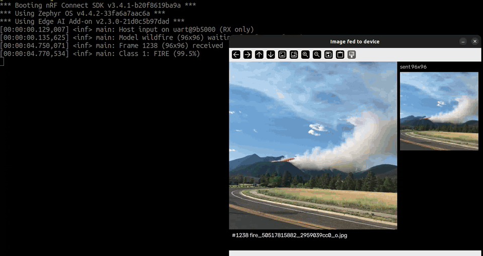

.. _app_image_classification:

Image classification
####################

.. contents::
   :local:
   :depth: 2

This application demonstrates image classification on the Axon NPU, using images streamed from a host PC over UART.

Application overview
********************

The application receives RGB565 frames from the host on a dedicated input UART, downscales them on the fly to the model input size, runs inference on the Axon NPU, and logs the top-1 class on the console.
No camera is required.
Nothing is sent back on the input UART, so a host script can show each image while the device console shows the classification result.

You can build the application with one of the following models:

.. list-table::
   :header-rows: 1

   * - Model
     - Kconfig option
     - Input
     - Classes
   * - CIFAR-10 image classification (``tinyml_ic``)
     - :kconfig:option:`CONFIG_IMG_CLASS_MODEL_CIFAR10` (default)
     - 32×32 RGB
     - airplane, automobile, bird, cat, deer, dog, frog, horse, ship, truck
   * - Visual Wake Words (``tinyml_vww``)
     - :kconfig:option:`CONFIG_IMG_CLASS_MODEL_VWW`
     - 96×96 RGB
     - non-person, person
   * - Wildfire (``wildfire``)
     - :kconfig:option:`CONFIG_IMG_CLASS_MODEL_WILDFIRE`
     - 96×96 RGB
     - no fire, fire

The CIFAR-10 and Visual Wake Words models are the MLPerf Tiny reference models.
The wildfire model is a MobileNetV1 0.25 (the Visual Wake Words backbone) fine-tuned from ImageNet weights on `The Wildfire Dataset <https://www.kaggle.com/datasets/elmadafri/the-wildfire-dataset>`_ (CC BY 4.0), a set of forest images with and without flames or smoke.
It classifies 88.8% of the 410 held-out test images correctly after int8 quantization.
The training, quantization, and Axon compilation pipeline is available in the `wildfire_axon <https://github.com/DematteisGiacomo/wildfire_axon>`_ repository.

The frames received from the host are not stored in full.
Pixels are box-filtered into the model input buffer while they arrive, so the host can send square frames from the model input size up to 16 times that size, for example 32×32 to 512×512 for CIFAR-10.
Frames with a CRC error, an unsupported size, or a broken header are dropped with a warning.

Frame format
============

Each frame is sent as a single message with the following little-endian layout:

.. code-block:: none

   [4B magic 0x12345AA5] [1B version = 1] [1B type = 0x01] [2B width] [2B height]
   [4B payload length] [4B frame ID] [payload: RGB565, big-endian] [4B CRC32 (IEEE) of payload]

Requirements
************

The application supports the following development kit:

.. table-from-sample-yaml::

The host PC requires Python 3 with ``pyserial``, ``numpy``, ``pillow``, and ``opencv-python`` to run the :file:`scripts/feed_images_uart.py` script.

On the nRF9251 DK, the UARTs are used as follows:

* ``uart133`` (VCOM0) - Console logs, including the classification results.
* ``uart132`` (VCOM1) - Frame input from the host, at 115200 baud.

User interface
**************

LED0 (frame LED):
   Toggles each time a valid frame is received.

LED1 (result LED):
   Turns on when the top-1 class probability reaches :kconfig:option:`CONFIG_IMG_CLASS_SCORE_THRESHOLD` (default 50%).

Configuration
*************

|config|

Configuration options
=====================

.. _CONFIG_IMG_CLASS_MODEL:

CONFIG_IMG_CLASS_MODEL_CIFAR10 / CONFIG_IMG_CLASS_MODEL_VWW / CONFIG_IMG_CLASS_MODEL_WILDFIRE
   Selects the model.
   The Axon interlayer buffer size (:kconfig:option:`CONFIG_NRF_AXON_INTERLAYER_BUFFER_SIZE`) follows the selected model.

.. _CONFIG_IMG_CLASS_SCORE_THRESHOLD:

CONFIG_IMG_CLASS_SCORE_THRESHOLD
   Top-1 probability, in per mille, at which LED1 turns on.

.. _CONFIG_IMG_CLASS_RX_BUF_SIZE:

CONFIG_IMG_CLASS_RX_BUF_SIZE
   Size of the input UART receive ring buffer.

Configuration files
===================

* :file:`prj.conf` - Default configuration, using the CIFAR-10 model.
* :file:`vww.conf` - Selects the Visual Wake Words model. Use it with ``EXTRA_CONF_FILE``.
* :file:`wildfire.conf` - Selects the wildfire model. Use it with ``EXTRA_CONF_FILE``.

Building and running
********************

.. |application path| replace:: :file:`applications/image_classification`

.. include:: /includes/application_build_and_run.txt

To build with the CIFAR-10 model, run:

.. code-block:: console

   west build -p -b nrf9251dk/nrf9251/cpuapp applications/image_classification
   west flash

To build with the Visual Wake Words model, run:

.. code-block:: console

   west build -p -b nrf9251dk/nrf9251/cpuapp applications/image_classification -- -DEXTRA_CONF_FILE=vww.conf
   west flash

To build with the wildfire model, run:

.. code-block:: console

   west build -p -b nrf9251dk/nrf9251/cpuapp applications/image_classification -- -DEXTRA_CONF_FILE=wildfire.conf
   west flash

Testing
=======

|test_application|

#. |connect_kit|
#. Open a terminal on VCOM0 (115200 baud) and reset the kit.
   The application logs ``Model ... waiting for frames from host``.
#. Run the feeder script on VCOM1, using the model the firmware was built with.

   For CIFAR-10, using the test inputs embedded in the model header:

   .. code-block:: console

      python3 applications/image_classification/scripts/feed_images_uart.py --model cifar10 \
         --port /dev/serial/by-id/usb-SEGGER_J-Link_<serial>-if02 --loop \
         --axon-test-vectors applications/image_classification/src/generated/nrf_axon_model_tinyml_ic_.h

   For CIFAR-10, using the official test set with the ground-truth label shown:

   .. code-block:: console

      python3 applications/image_classification/scripts/feed_images_uart.py --model cifar10 \
         --port /dev/serial/by-id/usb-SEGGER_J-Link_<serial>-if02 --loop \
         --cifar-test-batch cifar-10-batches-py/test_batch --count 20

   For Visual Wake Words, using your own pictures:

   .. code-block:: console

      python3 applications/image_classification/scripts/feed_images_uart.py --model vww \
         --port /dev/serial/by-id/usb-SEGGER_J-Link_<serial>-if02 --loop path/to/images/

   For the wildfire model, using forest pictures with and without fire or smoke:

   .. code-block:: console

      python3 applications/image_classification/scripts/feed_images_uart.py --model wildfire \
         --port /dev/serial/by-id/usb-SEGGER_J-Link_<serial>-if02 --loop path/to/forest/images/

   Use ``--size`` to send larger frames, for example ``--size 128`` for CIFAR-10 or ``--size 192`` for the 96×96 models.
   Larger frames take longer to transfer at 115200 baud.

#. Observe the image shown by the script and the classification result on the console.

Application output
==================

The following is an example output for the CIFAR-10 model:

.. code-block:: console

   <inf> main: Model tinyml_ic (32x32) waiting for frames from host
   <inf> main: Frame 1 (32x32) received
   <inf> main: Class 7: HORSE (50.9%)
   <inf> main: Frame 2 (32x32) received
   <inf> main: Class 1: AUTOMOBILE (100.0%)

The following is an example output for the wildfire model:

.. code-block:: console

   <inf> main: Host input on uart@9b5000 (RX only)
   <inf> main: Model wildfire (96x96) waiting for frames from host
   <inf> main: Frame 1238 (96x96) received
   <inf> main: Class 1: FIRE (99.5%)
   <inf> main: Frame 1240 (96x96) received
   <inf> main: Class 0: NO_FIRE (99.7%)

The following animation shows the wildfire model on the nRF9251 DK, with the device console on the left and the feeder script on the right.
The feeder window shows the original image and the 96×96 frame sent to the device:

Memory footprint
================

The following table shows the memory usage on the nRF9251 DK application core:

.. list-table::
   :header-rows: 1

   * - Model
     - Flash
     - RAM
   * - CIFAR-10
     - 192564 B (42%)
     - 75168 B (21%)
   * - Visual Wake Words
     - 335908 B (74%)
     - 142816 B (40%)
   * - Wildfire
     - 335956 B (74%)
     - 142816 B (40%)

Dependencies
************

This application uses the following |EAI| library:

* :ref:`lib_axon`

This application uses the following Zephyr libraries:

* :ref:`zephyr:logging_api`
* :ref:`zephyr:uart_api`
* :ref:`zephyr:ring_buffers_api`
